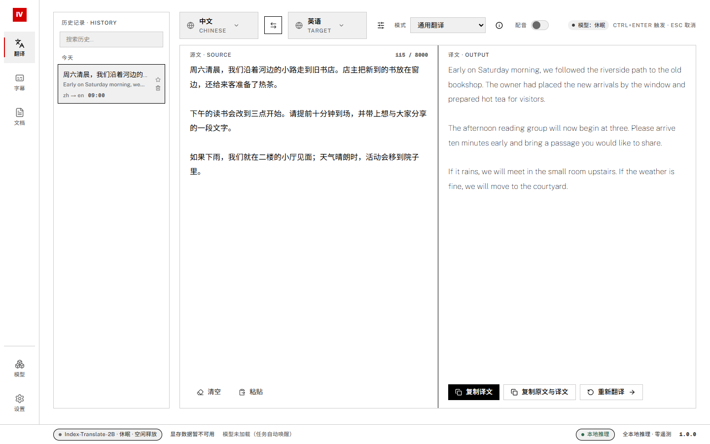
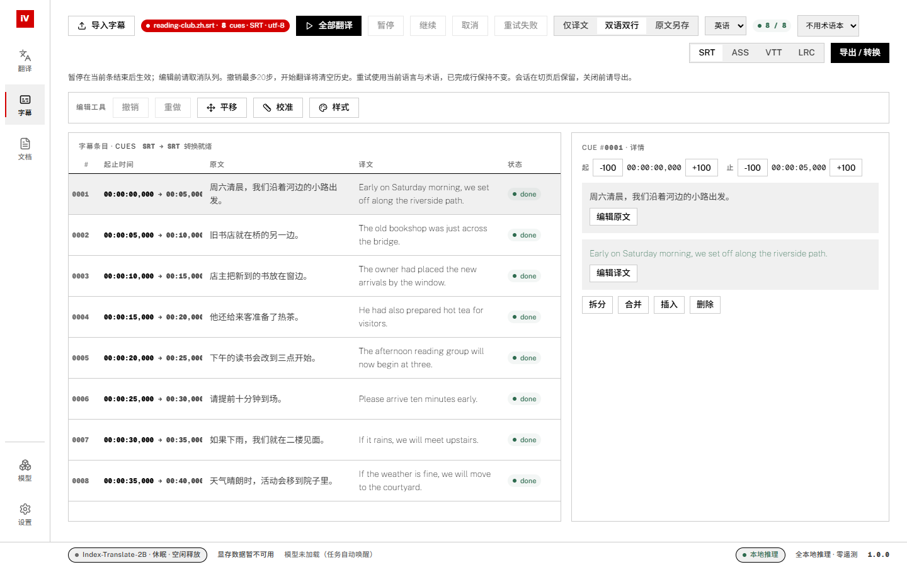

# Index-VT

**Local translation for text, subtitles, and long documents on Windows.**

English · [简体中文](README.zh-CN.md)

I built Index-VT to bring text translation, terminology, and subtitle editing into one desktop application. It runs IndexTeam's models locally through `llama-server`. After installing the engine and models, you can translate offline without sending your text to a cloud translation service.

Developed and maintained by **Osanai-Yuki**. Index-VT is an independent project; the models and inference engine are developed by their respective upstream teams.

> **Development preview.** Features are available for testing, with further hardware and workflow validation in progress. The application interface is primarily Simplified Chinese, with some English labels.



*Current interface, updated on 2026-10-19. The text and translations are public samples prepared for the screenshots. See the [capture notes](docs/assets/screenshots/README.md) for the build and rendering method.*

## What you can do

| Workspace | Features |
| --- | --- |
| Text translation | Streaming output, source/target language selection, built-in and custom translation presets, terminology hints, local history and favorites. |
| Subtitles | Import SRT, ASS, VTT, and LRC; translate a queue; pause, cancel, and retry failures; edit text and timing; split/merge cues; shift/calibrate timing; undo/redo edits; export translated or bilingual subtitles. |
| Long documents | Import TXT or Markdown, translate in chunks with Index-Nailong, continue an interrupted task during the same application session, inspect terminology matches, and export translation or bilingual text. |
| Models and terminology | Download supported GGUF models, choose Q4_K_M or Q8_0, and manage detected model files. Create and edit glossary books, import CSV/TSV, and export CSV. |
| Desktop controls | Light/dark/system themes, inference settings, local diagnostics, startup model loading, and automatic model release after inactivity. |



*Eight Chinese-to-English sample cues, with the selected cue's timing and text controls open. The built-in preview is for editing; check complex ASS effects in your target player.*

## Getting started

### Requirements

- **Windows 10/11, x64**, with Microsoft Edge WebView2 Runtime. This project currently targets Windows only.
- A compatible Windows build of **[llama.cpp](https://github.com/ggml-org/llama.cpp/releases)**, including `llama-server.exe` and the DLLs from that build.
- At least one supported GGUF model. An NVIDIA GPU with a compatible CUDA runtime is optional; CPU inference is available but speed depends on your machine.
- Disk space for the application, runtime, selected models, and local data. Each Q4_K_M model is roughly 1.3 GB and Q8_0 roughly 2.2 GB on disk; runtime memory usage depends on the model and context settings.

### Set up a portable folder

Check this repository's **Releases** section for downloadable builds and read the package description. An **app-only** archive needs the engine and models installed separately. GitHub's **Source code** archives are for building from source.

Extract the application to a writable folder and arrange the runtime like this:

```text
Index-VT/
├── Index-VT.exe
├── thirdparty/
│   └── llama-server/
│       ├── llama-server.exe
│       └── ... DLLs from the same runtime build
├── models/                  # created by the application
└── logs/                    # diagnostics, when logging is enabled
```

1. Start `Index-VT.exe` and follow the first-run setup.
2. Download **Index-Translate-2B / Q4_K_M** as a starting point, or place an official supported model file in `models/` before startup.
3. Open the translation workspace, choose a target language, and translate a short sample.
4. Add Nailong for long documents or Homura for dubbing-oriented text when needed.

Models and runtime binaries are excluded from the source repository. A fresh clone needs them too; cloning the project alone does not install the engine.

### Supported model roles

| Model | Used for | Current application scope |
| --- | --- | --- |
| [Index-Translate-2B](https://huggingface.co/IndexTeam/Index-Translate-2B-GGUF) | General text and subtitle translation | Language selection, translation constraints, and glossary hints. |
| [Index-Nailong-2B](https://huggingface.co/IndexTeam/Index-Nailong-2B-GGUF) | Long documents | Chinese ↔ English and Chinese ↔ Japanese. TXT/Markdown content is treated as text; exact formatting is not guaranteed. |
| [Index-Homura-2B](https://huggingface.co/IndexTeam/Index-Homura-2B-GGUF) | Dubbing-oriented text translation | Approximate syllable-budget control. This application does not synthesize audio or dub video. |

The model manager supports **Q4_K_M** and **Q8_0**. For manual installation, keep the official file names, for example `Index-Translate-2B.Q4_K_M.gguf`. Downloads support resuming and Hugging Face/ModelScope sources; installation requires a successful checksum verification. If verification cannot be completed, the partial download is kept for a retry.

### Everyday use

- **Text:** choose the languages and a preset, enter your text, then translate. `Ctrl+Enter` starts a translation; `Esc` cancels it.
- **Subtitles:** import a file, choose a language and optional glossary, translate, inspect the result, then export. Cancel the active queue before editing. Undo history is limited to 20 steps and a memory budget; starting a new translation clears it.
- **Documents:** import a TXT/MD file and select one of the supported directions. The current import limit is **2 MiB and 50,000 Unicode characters**. Export the result before closing the application.
- **Glossaries:** manage books in the model/terminology workspace. Entries are passed to the model as translation hints. Review the result: term-match counts help locate passages, but do not establish semantic consistency.

After setup, the saved default model loads at startup. With no active task, **30 minutes without input** starts a **30-second countdown** to release the model; interaction cancels the countdown, and a later task loads the model again.

## Your files and privacy

The normal portable layout keeps data beside the executable:

| Location | Contents |
| --- | --- |
| `models/*.gguf` | Downloaded model weights. |
| `models/data/indexvt.db` | Local settings, text history, glossary books, and model records. |
| `logs/` | Application/engine logs and diagnostic archives, if enabled. |

Inference runs on `127.0.0.1`, without a cloud API key or application telemetry. Model downloads contact the selected model host. Logging is off by default, and changes to that setting take effect after restarting. Check diagnostic files for local paths and other information before sharing them.

**Export subtitle and document work before exiting.** Switching pages preserves the current session, but those workspaces do not automatically restore unfinished work after a full application restart. Back up the portable folder with the application closed if you want to retain models, settings, history, and glossaries. Development builds can resolve their data folder above the executable; see the [development guide](docs/DEVELOPMENT.md).

## Build from source

The stack is **Go / Wails v2 / React / TypeScript / Tailwind CSS / SQLite / llama.cpp**.

Install Go **1.25 or newer** (the selected dependency versions may require a newer toolchain), Node.js **22 or newer**, and Wails CLI **v2.16.0** with its Windows build prerequisites. Run the following in PowerShell from the repository root:

```powershell
go install github.com/wailsapp/wails/v2/cmd/wails@v2.16.0
npm --prefix frontend ci
node scripts/build.mjs
```

The executable is written to `app/build/bin/Index-VT.exe`. Add the runtime/model files as described above to use it.

**Build production releases with this script.** It builds the frontend, synchronizes Go's embed directory, then compiles the executable. Running `wails build` directly can leave an older interface embedded in the application.

For local development, test commands, and browser demos, see [DEVELOPMENT.md](docs/DEVELOPMENT.md).

## Current limitations

I am continuing to test native Windows workflows and translation quality on representative material. Browser tests cover interface behavior; real model inference, native dialogs, and hardware compatibility need separate checks.

- Translation can omit, distort, or invent content. Check important output against the source; terminology-match counts are review hints.
- Full restart recovery is not available for subtitle/document sessions. A document continuation uses the original task's direction and terminology.
- Complex ASS styling and behavior can differ from external players. Document chunking can change whitespace and layout.
- Homura's syllable count and the displayed GPU-memory estimates are approximate; neither is a hardware or output guarantee.
- Real IME input, unusual display scaling, interrupted downloads, low disk space, CPU performance, and driver/OOM recovery still need broader acceptance testing.

Dated test results and engineering notes are indexed in [docs/README.md](docs/README.md), with the scope and limitations of each check recorded alongside the results.

## Feedback

To report a problem, include the application version (`Index-VT.exe -version`), Windows version, GPU/CPU, model and quantization, context size, and steps to reproduce. Include a small sample you can share publicly, and review any logs before attaching them.

## Copyright and licensing

**Copyright (c) 2026 Osanai-Yuki.** This notice covers original project work; third-party materials retain their own ownership and terms. See [COPYRIGHT](COPYRIGHT) and [THIRD_PARTY_NOTICES.md](THIRD_PARTY_NOTICES.md).

Original Index-VT code, documentation, and interface assets are available under the **[MIT License](LICENSE)**. Model weights, fonts, dependencies, and runtime binaries retain their respective upstream licenses. See the [licensing guide](docs/LICENSING.zh-CN.md) for scope and distribution details.

Maintainer resources: [release guide](docs/RELEASING.zh-CN.md) · [file cleanup review](docs/CLEANUP-2026-10-18.md).
