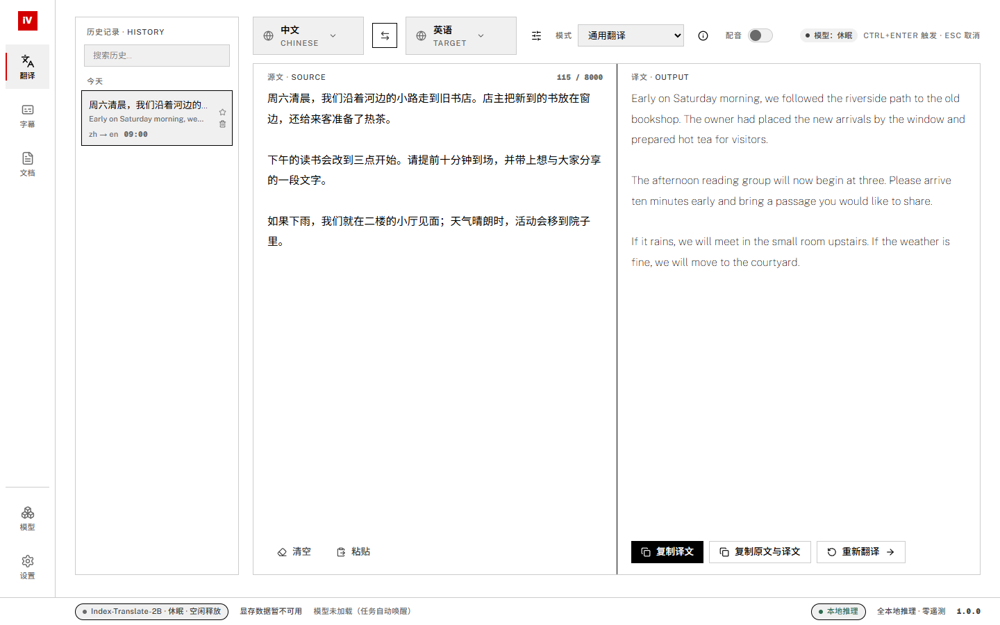
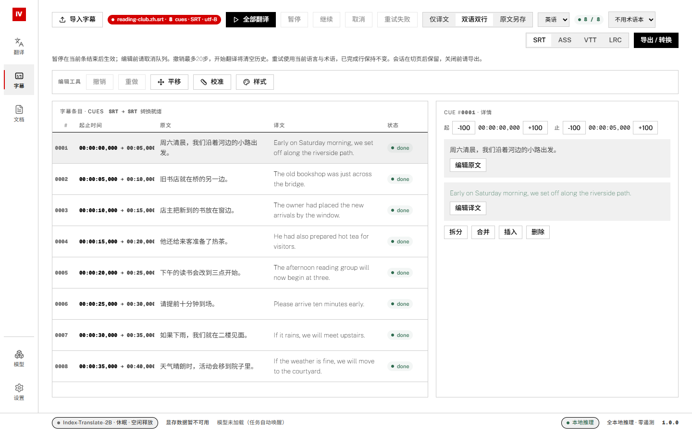

# Index-VT

**在 Windows 上本地完成文本、字幕和长文档翻译。**

[English](README.md) · 简体中文

我开发 Index-VT，是想在一个桌面应用里完成文本翻译、术语管理和字幕编辑。应用通过 `llama-server` 在本机运行 IndexTeam 模型。安装好引擎和模型后，就能离线翻译，无需将文本上传到云端翻译服务。

开发与维护：**Osanai-Yuki**。Index-VT 是独立项目，模型和推理引擎由各自的上游团队开发。

> **当前为开发预览版。** 已有功能可供试用，硬件适配和 Windows 工作流仍在继续验收。应用界面以简体中文为主，带部分英文标签。



*当前界面，更新于 2026-10-19。原文和译文均为专门准备的公开示例，用于展示操作界面；构建来源和截图方式见[截图说明](docs/assets/screenshots/README.md)。*

## 可以做什么

| 工作区 | 功能 |
| --- | --- |
| 文本翻译 | 流式输出、源语言与目标语言选择、内置和自定义翻译模式、术语提示、本地历史与收藏。 |
| 字幕工作台 | 导入 SRT、ASS、VTT、LRC；队列翻译、暂停、取消和失败重试；编辑文本与时间；拆分、合并、平移与校准；撤销/重做；导出译文或双语字幕。 |
| 长文档 | 导入 TXT 或 Markdown，以 Index-Nailong 分块翻译；同一次应用会话内继续中断任务；检查术语命中；导出译文或双语对照。 |
| 模型与术语 | 下载受支持的 GGUF 模型，选择 Q4_K_M 或 Q8_0，管理识别出的模型文件；新建、编辑术语本，导入 CSV/TSV，导出 CSV。 |
| 桌面设置 | 浅色、深色与跟随系统主题；推理参数；本地诊断；启动加载默认模型；空闲后释放模型。 |



*八条中文到英文的示例字幕，右侧为所选条目的时间和文本编辑控件。内置预览用于编辑，复杂 ASS 效果请在实际使用的播放器中检查。*

## 开始使用

### 环境要求

- **Windows 10/11，x64**，并安装 Microsoft Edge WebView2 Runtime。目前只面向 Windows。
- 可兼容的 **[llama.cpp Windows 发行包](https://github.com/ggml-org/llama.cpp/releases)**，包括 `llama-server.exe` 及同一构建附带的 DLL。
- 至少一个受支持的 GGUF 模型。NVIDIA GPU 和对应 CUDA 运行环境为可选项；可以使用 CPU，速度取决于硬件。
- 为应用、引擎、模型和本地数据预留磁盘空间。单个 Q4_K_M 模型约 1.3 GB，Q8_0 约 2.2 GB；运行时的内存和显存占用还取决于模型与上下文设置。

### 准备便携目录

在仓库的 **Releases** 中查看可下载的版本和附件说明。标有 **app-only** 的包需要另行安装引擎和模型；**Source code** 压缩包用于从源码构建。

将应用解压到可写目录，按下面的结构放置引擎：

```text
Index-VT/
├── Index-VT.exe
├── thirdparty/
│   └── llama-server/
│       ├── llama-server.exe
│       └── ... 同一引擎发行包附带的 DLL
├── models/                  # 应用自动创建
└── logs/                    # 启用日志后保存诊断信息
```

1. 打开 `Index-VT.exe`，按首次引导准备环境。
2. 建议先下载 **Index-Translate-2B / Q4_K_M**；也可以在启动前把受支持的官方模型文件放入 `models/`。
3. 在主翻译台选择目标语言，用一小段文本确认环境可用。
4. 需要长文档翻译时添加 Nailong，需要配音文本约束时添加 Homura。

源码仓库不包含模型和引擎二进制。自行克隆项目也需要补齐这些文件。

### 三个模型的分工

| 模型 | 用途 | 当前应用范围 |
| --- | --- | --- |
| [Index-Translate-2B](https://huggingface.co/IndexTeam/Index-Translate-2B-GGUF) | 通用文本、字幕翻译 | 语言选择、翻译约束和术语提示。 |
| [Index-Nailong-2B](https://huggingface.co/IndexTeam/Index-Nailong-2B-GGUF) | 长文档翻译 | 中文 ↔ 英文、中文 ↔ 日文。TXT/Markdown 按文本处理，不保证原排版完全保留。 |
| [Index-Homura-2B](https://huggingface.co/IndexTeam/Index-Homura-2B-GGUF) | 面向配音的文本翻译 | 近似音节预算控制。本应用不合成音频，也不直接为视频配音。 |

模型管理支持 **Q4_K_M**、**Q8_0**。手动放置时保留官方文件名，例如 `Index-Translate-2B.Q4_K_M.gguf`。下载支持 Hugging Face / ModelScope 源和断点续传；只有校验通过才安装，无法完成校验时保留下载进度供重试。

### 常用操作

- **文本：**选择语言和模式后翻译；`Ctrl+Enter` 开始，`Esc` 取消。
- **字幕：**导入文件、选择语言和可选术语本，翻译后检查并导出。编辑前先取消活动队列。撤销历史最多 20 步，并受内存预算限制；开始新一轮翻译会清空撤销历史。
- **文档：**导入 TXT/MD，选择受支持的方向。当前导入上限为 **2 MiB 且不超过 50,000 个 Unicode 字符**。关闭应用前导出结果。
- **术语：**在模型与术语工作区维护术语本。词条会作为翻译提示传给模型，结果仍需检查；命中计数可以帮助定位段落，但不能判断语义是否一致。

完成引导后，应用在启动时加载保存的默认模型。没有活动任务且 **30 分钟无操作**时，会提示 **30 秒倒计时**后释放模型；继续操作会取消倒计时，后续翻译会重新加载模型。

## 数据与隐私

正常便携布局下，数据位于可执行文件旁：

| 路径 | 内容 |
| --- | --- |
| `models/*.gguf` | 下载的模型权重。 |
| `models/data/indexvt.db` | 设置、文本历史、术语本和模型登记信息。 |
| `logs/` | 启用日志后生成的应用日志、引擎日志及诊断包。 |

推理在 `127.0.0.1` 上运行，无需云端 API Key，也没有应用遥测。下载模型时会连接所选托管站点。日志默认关闭，修改开关后重启生效；分享诊断文件前，请检查其中的本机路径和其他信息。

**退出前请导出字幕和文档。** 切换页面会保留本次会话，但应用完全关闭后，字幕和文档工作区不会自动恢复未完成内容。备份时先关闭应用，再复制整个便携目录，以保留模型、设置、历史和术语本。开发环境可能使用可执行文件上层的资源目录，详见[开发指南](docs/DEVELOPMENT.md)。

## 从源码构建

技术栈：**Go / Wails v2 / React / TypeScript / Tailwind CSS / SQLite / llama.cpp**。

安装 Go **1.25 或更新版本**（锁定的依赖可能要求更新的工具链）、Node.js **22 或更新版本**、Wails CLI **v2.16.0** 及其 Windows 构建依赖。在仓库根目录用 PowerShell 执行：

```powershell
go install github.com/wailsapp/wails/v2/cmd/wails@v2.16.0
npm --prefix frontend ci
node scripts/build.mjs
```

输出为 `app/build/bin/Index-VT.exe`，运行前按前文补齐引擎和模型。

**生产构建请使用这个脚本。** 它依次构建前端、同步 Go 的嵌入目录，再编译应用。直接执行 `wails build` 可能让程序继续使用旧界面。

热更新、测试命令和浏览器演示见 [DEVELOPMENT.md](docs/DEVELOPMENT.md)。

## 当前限制

我仍在用代表性材料检查翻译质量，并继续验收 Windows 原生工作流。浏览器测试覆盖界面行为，真实模型、原生对话框和硬件适配还需分别验证。

- 模型可能漏译、误译或增添内容，重要译文请对照原文检查；术语命中只提供审阅线索。
- 字幕和文档不支持跨应用重启恢复。文档续跑沿用任务开始时的方向与术语。
- 复杂 ASS 样式在不同播放器中可能有差异；文档分块也可能改变空白与排版。
- Homura 音节数和界面中的显存估算均为近似值，不是输出或硬件适配保证。
- 真实输入法、特殊缩放、下载中断、磁盘不足、CPU 性能和驱动/OOM 恢复仍需更广泛验收。

测试结果和工程记录见[文档索引](docs/README.md)，各项检查都注明了日期、验证范围和限制。

## 反馈问题

反馈时请附上应用版本（`Index-VT.exe -version`）、Windows 版本、GPU/CPU、模型与量化档位、上下文大小和复现步骤。样例只需提供可以公开的一小段，日志也请检查后再上传。

## 版权与许可

**Copyright (c) 2026 Osanai-Yuki。** 此声明针对项目原创部分，第三方材料保留各自权利和条款，见 [COPYRIGHT](COPYRIGHT) 与 [THIRD_PARTY_NOTICES.md](THIRD_PARTY_NOTICES.md)。

Index-VT 原创代码、文档和界面资产采用 **[MIT 协议](LICENSE)**。模型、字体、依赖和运行时分别保留各自的上游许可；适用范围及分发要求见[许可指南](docs/LICENSING.zh-CN.md)。

维护文档：[发布指南](docs/RELEASING.zh-CN.md) · [文件清理记录与剩余候选](docs/CLEANUP-2026-10-18.md)。
