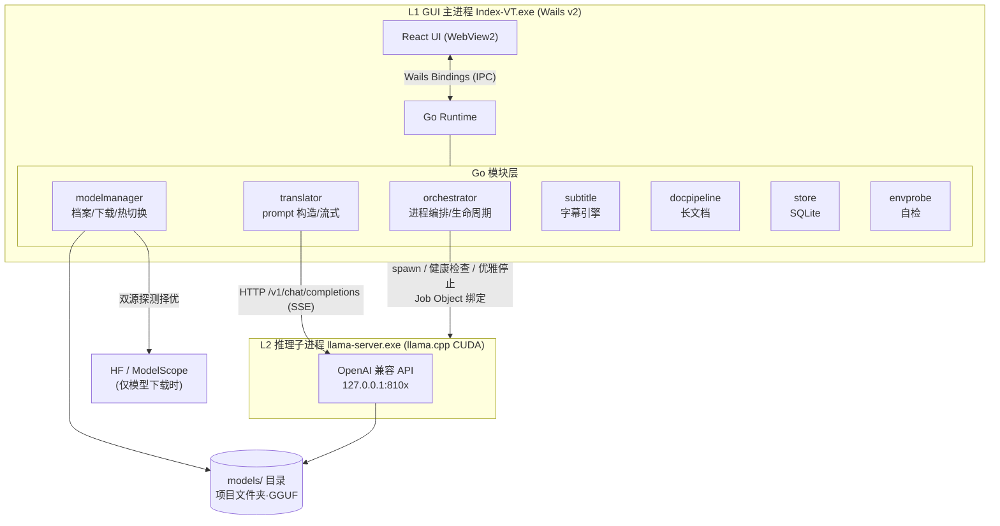
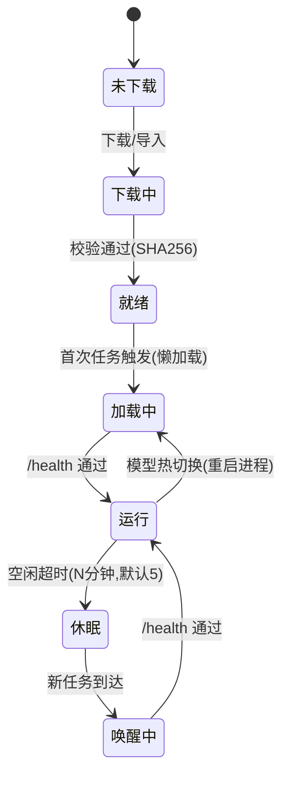

# Index-VT 设计方案文档

| | |
|---|---|
| **版本** | 1.0（设计冻结候选） |
| **日期** | 2026-10-04 |
| **配套文档** | 02-执行细节说明.md、03-GUI设计图/、04-交付与验收方案.md |
| **决策记录** | `.archcore/adrs/`（ADR-001 ~ ADR-007） |

---

## 1. 产品概述

### 1.1 定位

**Index-VT** 是一款运行于 Windows 的全本地 AI 桌面文本翻译工具：双击 exe 即用，基于 Bilibili IndexTeam 开源的 Index-Translate 模型家族（Apache-2.0）与 llama.cpp CUDA 推理栈，除首次模型下载外零网络依赖、零遥测，敏感文本不出本机。

### 1.2 目标用户

| 用户群 | 核心诉求 | 对应功能 |
|---|---|---|
| 隐私敏感用户（法律/商务/医疗文本） | 文本不出本机 | 全本地推理、离线可用 |
| 无稳定外网环境用户 | 断网可用 | 模型就绪后零网络请求 |
| 字幕组/自媒体译者 | 翻译+时间轴+样式+导出一站式 | 字幕工作台 |
| 内容出海创作者 | 配音文案与画面时长对齐 | 配音模式（音节预算） |
| 长文本读者/译者 | 整本小说/论文翻译，人名前后一致 | 文档翻译（Index-Nailong） |

### 1.3 四大场景

1. **即输即译 + 约束翻译**（主场景）：双栏输入输出，150 语言，支持术语表/格式保持/风格文体约束（instTrans 指令体系）。
2. **字幕翻译工作台**（特色场景）：SRT/ASS/VTT/LRC 字幕文件导入 → 逐条翻译 → 编辑（时间/拆分/合并）→ 样式编辑 → 格式转换导出。纯文本链路，不涉及音频。
3. **长文档翻译**：txt/md 整文翻译（Index-Nailong 原生长上下文），人名与术语跨章节一致。
4. **配音文案模式**：指定目标音节数的翻译（Index-Homura），用于配音时长对齐。

### 1.4 竞品参照

- **DeepL 桌面版**：即输即译双栏交互范式、Ctrl+Enter 触发、历史记录——借鉴其主界面信息架构。
- **Subtitle Edit**：cue 列表 + 时间轴微调 + 样式编辑的成熟工作流——借鉴其字幕工作台布局（左侧 cue 表格 + 右侧编辑/预览）。
- **差异点**：两者均为在线/混合引擎或功能单一工具；Index-VT 以本地模型 + 三模型分工 + 字幕后期全链路作为差异组合。

### 1.5 非目标

- **音频/语音识别与语音字幕**：Index-Echo 系列的官方 GGUF 仅含 LLM backbone（音频塔与连接器不在内），纳入将破坏纯 llama.cpp 架构（详见 ADR-002）。
- **视频画面 OCR 字幕提取**：图像链路，远期评估。
- **在线翻译引擎回退/聚合**：与全本地定位冲突。

---

## 2. 总体架构

### 2.1 两层进程架构



- **L1 GUI 主进程** `Index-VT.exe`：Wails v2（Go runtime + WebView2 内嵌 React UI）。职责：进程编排、模型管理、翻译编排、prompt 构造、配置与历史持久化。
- **L2 推理子进程** `llama-server.exe`（llama.cpp CUDA 构建，随主程序分发）：监听 `127.0.0.1` 动态端口（默认 8101，冲突时递增至 8101-8110 池）。**同一时刻仅加载一个模型**；模型切换时优雅重启进程（llama-server 单进程单模型；2B Q4_K_M 加载实测预期 <10s）。
- **全栈零 Python**：模型下载由 Go 自研下载器完成（HTTP Range 断点续传 + SHA256 校验 + HF/ModelScope 双源探测择优）。

### 2.2 关键架构决策摘要

| # | 决策 | ADR |
|---|---|---|
| 1 | GUI 用 Go + Wails v2（vs Tauri/Electron/WinUI） | ADR-001 |
| 2 | 推理栈纯 llama.cpp CUDA + GGUF，零 Python | ADR-002 |
| 3 | 单 llama-server 懒加载 + 热切换（vs 多实例常驻） | ADR-003 |
| 4 | Homura 以"配音模式"融入主翻译台 | ADR-004 |
| 5 | 模型存项目文件夹 `models/`，本地优先，双源网络自适应 | ADR-005 |
| 6 | 空闲自动卸载 + 关闭全量释放 + Job Object 崩溃兜底 | ADR-006 |
| 7 | 字幕引擎 go-astisub + 自研 LRC 补充；翻译走文本队列 | ADR-007 |

---

## 3. 模型矩阵

### 3.1 模型档案

| 模型 | 仓库（HF） | 职责 | 默认量化 | 权重体积 | 采样参数 |
|---|---|---|---|---|---|
| **Index-Translate-2B** | `IndexTeam/Index-Translate-2B-GGUF` | 主翻译：150 语言 + 指令约束 + 字幕逐条翻译 | Q4_K_M（可切 Q8_0） | 1.31GB / 2.08GB(Q8) | greedy，temperature=0 |
| **Index-Nailong-2B** | `IndexTeam/Index-Nailong-2B-GGUF` | 长文档：zh↔en / zh↔ja 固定方向模板 | Q4_K_M | ≈1.3GB | greedy，temperature=0，stop_token_ids=[248044,248046] |
| **Index-Homura-2B** | `IndexTeam/Index-Homura-2B-GGUF` | 配音模式：目标音节预算 | Q4_K_M | ≈1.3GB | sampling，temperature=0.3 |

- ModelScope 镜像：`https://modelscope.cn/models/IndexTeam/<同名仓库>`（国内网络优先）。
- Q4_K_M 为官方验证档（"Generation outputs of Q4_K_M matched the reference almost verbatim"，HF 仓库一致性验证，2026-10-03）。
- 三模型语言/能力边界（如实呈现于 UI）：
  - Translate：150 语言，源 auto 检测；2B 在低资源语言上 off-target 率 4.2%（官方评测）→ UI 提供 off-target 警告徽标补偿。
  - Nailong：仅 zh↔en / zh↔ja 四个方向（`zh-en / en-zh / zh-ja / ja-zh` 模板）。
  - Homura：音节控制为**近似达标**（官方 9B 在 SandGlass 81.92% within 10%；2B 更弱）→ UI 回显实测音节数并支持重 roll。

### 3.2 VRAM 预算

| 档位 | Q4_K_M + ctx 8K | Q8_0 + ctx 8K | Nailong + ctx 32K |
|---|---|---|---|
| 权重 | 1.31GB | 2.08GB | 1.31GB |
| KV cache + 激活（估算） | ≈1.5GB | ≈2.3GB | ≈3.5GB |
| **合计** | **≈3GB** | **≈4.5GB** | **≈5GB** |

- 4GB 显卡：Q4_K_M + ctx 8K（`-ngl` 部分层卸载兜底）；6GB：Q4_K_M 全卸载 + ctx 16K；8GB+：Q8_0 或 Nailong ctx 32K。
- 无 GPU：CPU 推理可用（`-ngl 0`），启动自检显示性能预期提示。
- 详细降级策略与风险见 02-执行细节说明.md §2。

---

## 4. Prompt 管线（逐字对齐官方模板）

`translator` 模块内置三套 prompt 构造器，格式**逐字移植**官方仓库（`bilibili/Index-Translate` inference/llm），禁止自创模板。

### 4.1 Translate（Index-Translate）

**无约束（source=auto 时省略源语言）：**

```text
请将以下{源语言}文本翻译为{目标语言}，直接输出翻译结果，不要进行任何解释。
{源文}
```

**instTrans 约束（存在 -g/-H/-S/-d 任一约束时启用）：**

```text
请将以下{源语言}{文体}翻译成{目标语言}，并且严格遵循所有约束要求。
【源文】
{源文}
【约束要求】
1. 【硬性要求】{格式保持/术语表/社交元素保持...}
2. 【注意】{风格/文体/领域消歧...}
只输出译文，不要有任何额外说明。
```

- 术语表（-g）：`【硬性要求】专名/术语对照: A→B、C→D`
- JSON 字典格式保持时，后缀自动切换为 instTrans 标准 JSON 输出指令。

### 4.2 Homura（配音模式）

```text
请将以下文本翻译为{目标}，译文严格控制在 {N} 个音节。要求：严格遵守术语映射表【{术语 -> 译名}】。直接输出翻译结果，不要有任何解释。
{text}
```

- 无术语表时省略"要求"子句。max_tokens = max(512, 3×源文字符数)（防截断）。
- 输出后由前端计算实测音节数（按目标语言音节规则），回显"目标 N / 实测 M"。

### 4.3 Nailong（文档翻译）

- 按方向加载固定模板（对应官方 `prompts/nailong_{zh-en,en-zh,zh-ja,ja-zh}.txt`），将占位标记替换为完整原文。
- 请求必须携带 `stop_token_ids=[248044, 248046]`（官方文档翻译终止符），并保持 greedy。
- ctx 档位由 UI 决定（8K/16K/32K），见 02 文档 §3。

### 4.4 字幕逐条翻译

- 对每个 cue 的文本行调用 Translate 模板（无约束或带术语表约束）；样式标签（如 ASS 覆写标签）在构造 prompt 前剥离、翻译后回填（详见 02 文档 §11）。
- 逐条独立请求、温度 0、失败单条重试（最多 2 次），队列可暂停/取消。

### 4.5 参数映射表（translator → llama-server 请求体）

| 模型 | temperature | top_p | top_k | stop | max_tokens | stream |
|---|---|---|---|---|---|---|
| Translate | 0.0 | -（默认） | - | EOS（默认） | 1024（默认；约束/长文可调） | true |
| Homura | 0.3 | - | - | EOS | max(512, 3×len(text)) | true |
| Nailong | 0.0 | 1.0 | -1（关闭） | **[248044, 248046]** | 服务端按 ctx 上限 | true |
| 字幕逐条 | 0.0 | - | - | EOS | 512 | false（队列场景逐条非流式亦可，UI 逐条刷新） |

---

## 5. 核心模块设计（Go）

### 5.1 orchestrator — llama-server 编排

**职责**：子进程生命周期、端口池、健康检查、空闲卸载、退出清理、残留清扫。

```go
type Orchestrator interface {
    EnsureRunning(model ModelRef) (Endpoint, error)      // 幂等：未运行则启动/休眠则唤醒/运行中则复用
    Stop(gracefulTimeout time.Duration) error          // 优雅停止，超时强杀
    Endpoint() (Endpoint, bool)                          // 当前端点
    State() OrchestrationState                           // idle | starting | running | stopping | crashed
    OnState(fn func(OrchestrationState))                 // 状态变更订阅（驱动前端徽标）
}
```

**llama-server 启动参数**（由模型档案 + 用户设置合成）：

```text
llama-server.exe -m "models/Index-Translate-2B.Q4_K_M.gguf" \
  -ngl 99 -c 8192 -fa --host 127.0.0.1 --port 8101 \
  --no-webui -ngl {用户设置覆盖}
```

**生命周期状态机**（模型视角七态）：



**资源与进程生命周期策略**：

- **空闲自动卸载**：所有翻译/文档/字幕任务完成或取消且无下载进行时起计时；持续 N 分钟（默认 5，设置 1-30 或常驻）→ 优雅停止 llama-server → 显存/内存释放。卸载前持锁二次确认无新任务（shutdown 与新任务竞争的锁顺序：先取任务锁、再判定、再停止）。任何新任务到达立即中止卸载并复用进程。
- **程序关闭全量释放**：退出流程 = ① 取消所有进行中任务（断开 SSE）→ ② 等 HTTP 连接关闭（≤1s）→ ③ 优雅停止 llama-server（超时 3s 强杀）→ ④ Job Object 句柄信号确认子进程终止 → ⑤ 上报退出码。UI 显示"正在释放模型资源…"过渡态。
- **崩溃兜底**：llama-server 加入 Windows Job Object（`JOB_OBJECT_LIMIT_KILL_ON_JOB_CLOSE`），主进程任何形式退出（含崩溃）时子进程随之终止；主进程下次启动时按指纹清扫残留（`进程名=llama-server` 且 `命令行含本项目 models\ 路径` 且 `监听端口∈8101-8110`——避免误杀用户自己的 llama.cpp 实例）。
- **崩溃自动重启**：运行中 llama-server 意外退出时按指数退避重启（1s/2s/4s，3 次失败转 crashed 态并提示）。
- **关闭语义**：仅"退出程序"触发全量释放；最小化到托盘不卸载（可选驻留，默认退出即释放）。

### 5.2 modelmanager — 模型档案与下载

**职责**：模型注册表、本地扫描、双源下载器、量化档位、导入/删除。

```go
type ModelManager interface {
    ScanLocal() []ModelInfo                          // 启动扫描 models/（文件名模式 + GGUF 头 metadata 双重识别）
    List() []ModelInfo                               // 三模型档案（含七态）
    Download(id ModelID, quant QuantKind, src SourcePref) (<-chan DownloadProgress, error)
    CancelDownload(id ModelID) error
    ImportGGUF(path string) (ModelInfo, error)        // 从任意路径导入（拷贝入 models/）
    Delete(id ModelID, quant QuantKind) error
    SetActive(id ModelID)                            // 请求 orchestrator 热切换
}
```

**模型存储与加载策略**：

- **存储位置**：项目文件夹 `models/`（exe 同级），便携布局——整个目录拷贝到其他机器即可用，不使用 AppData/用户缓存。
- **本地优先读取**：启动即扫描 `models/`——GGUF 文件按两层规则识别：① 文件名模式 `Index-*-2B.Q*.gguf`；② 读取 GGUF 头 metadata（`general.name` / `general.architecture`）验证模型类型与量化档位。SHA256 校验通过的直接标记"就绪"，跳过下载。用户手动放入文件或"从本地导入"（浏览任意路径 .gguf，校验后拷贝登记）均支持。
- **双源网络自适应**：下载前并发探测两源（对仓库根文件发 HEAD 请求，5s 超时），按连通性 + 延迟择优；HF 不可达或延迟 >3 倍于 ModelScope 时自动切换；探测结果以徽标显示在模型中心，设置页可固定偏好（自动 / 优先 HF / 优先 ModelScope）。
- **断点续传**：HTTP Range 续传仅限同源（HF 与 ModelScope 的 ETag 不一致，跨源续传会产出损坏文件——切源即重下，见 02 文档 §4）。

### 5.3 translator — 翻译编排

**职责**：prompt 构造（§4 三套模板）、流式调用、参数映射、取消传播、off-target 检测数据。

```go
type Translator interface {
    Translate(ctx context.Context, req TranslateRequest, onDelta func(string)) (TranslateResult, error)
    // req: {SourceLang, TargetLang, Text, Constraints{Glossary, Hard[], Soft{}, Genre}, Mode{Normal|Dubbing{Syllables}}}
    // result: {Output, OffTargetSuspect bool, TargetSyllables/ActualSyllables(配音模式), TokensPerSec, FirstTokenLatency}
    CancelActive(taskID string) error
}
```

**数据流**：前端提交任务 → translator 构造 prompt + 参数 → 检查 orchestrator 状态（未运行则唤醒，UI 显示"模型唤醒中"）→ POST `/v1/chat/completions`（SSE）→ 增量回调前端打字机 → 完成后写历史（store）并做 off-target 粗检（Unicode 脚本分布 vs 目标语言期望脚本）。

**取消传播**：context 取消 → 断开 HTTP 连接 → llama-server 中止生成并释放槽位；前端 ≤100ms 响应。

### 5.4 subtitle — 字幕引擎

**职责**：多格式解析/序列化、cue 数据模型、翻译队列、双语合成、样式系统、导出。

```go
type SubtitleEngine interface {
    Open(path string) (SubtitleDoc, error)            // 自动识别格式+编码（UTF-8/UTF-8-BOM/GBK）
    Export(doc SubtitleDoc, opt ExportOptions) error   // 格式(SRT/ASS/VTT/LRC/TXT)+编码(UTF-8/GBK)+双语模式
    TranslateQueue(docID string, opt QueueOptions) (<-chan CueProgress, error)
    // opt: {TargetLang, GlossaryID, BilingualMode, Overwrite}
    RetryCue(docID string, cueIDs []int) error
    UpdateCue(docID string, cue Cue) error             // 文本/时间编辑
    SplitCue / MergeCues / InsertCue / DeleteCue(docID string, ...)
    ShiftAll(docID string, delta time.Duration) error
    Calibrate(docID string, p1, p2 AnchorPoint) error   // 两点线性校准
    Styles(docID string) StyleLibrary                  // 通用样式 + ASS Style 定义
}
```

- **Cue 数据模型**：`{Index, StartMs, EndMs, Original, Translated, StyleName, State(pending|translating|done|failed|skipped), OffTarget bool}`。
- **库选型**：`go-astisub`（MIT）承担 SRT/ASS/TTML/STL/WEBVTT 解析与序列化；LRC 为自研补充（go-astisub 不支持）。ASS 覆写标签（`{\i1}` 等）在翻译前剥离、译后回填（详见 02 文档 §11）。
- **队列策略**：单 worker 逐条请求（避免并发槽位竞争），每条失败独立重试（≤2 次），整体进度 = done/total；5000+ cue 文件启用前端虚拟列表 + 后端批量事件合并（100ms 节流）。
- **双语合成**：三种模式——仅译文 / 原文+译文双行（原文上、译文下）/ 保留原文另存（生成两个文件）。

### 5.5 docpipeline — 长文档翻译

**职责**：txt/md 读取（编码检测）、Nailong 方向模板、流式进度、对照导出。

```go
type DocPipeline interface {
    Translate(ctx context.Context, req DocRequest, onProgress func(DocProgress)) error
    // req: {Path, Direction(zh-en|en-zh|zh-ja|ja-zh), CtxTier(8K|16K|32K)}
    Export(docID string, kind ExportKind) error        // 译文 / 双语对照（段落间分隔）
    Cancel(docID string) error
}
```

- ctx 档位决定 llama-server 启动参数 `-c`；UI 显示各档 VRAM 提示并按 envprobe 检测结果给默认推荐。

### 5.6 store — 持久化

- **技术**：`modernc.org/sqlite`（纯 Go，免 CGO——Wails 打包免 mingw）。
- **表**：`history(id, created_at, source_lang, target_lang, source_text, output, model, mode, starred)`；`glossaries(id, name)` + `glossary_items(glossary_id, term, translation)`；`config(key, value)`（JSON 序列化）。
- **位置**：项目文件夹 `data/indexvt.db`（与 `models/` 同级，保持便携性）。

### 5.7 envprobe — 启动自检

**职责**：GPU/VRAM 检测（`nvidia-smi --query-gpu=name,memory.total,memory.used --format=csv,noheader`）、llama-server.exe 存在性、`models/` 扫描结果、残留进程清扫触发。

- 无 GPU：UI 顶部持续横幅"CPU 推理模式，速度约为 GPU 的 1/10 [assumption]，长文档与字幕批量任务耗时显著增加"。
- WebView2 缺失：引导下载 offline installer（仅极老 Win10 需要）。

---

## 6. 前端设计

### 6.1 技术栈与信息架构

- **React 18 + TypeScript + Vite + Tailwind CSS 4 + lucide-react 图标**。
- **IA 五页 + 引导**：主翻译台 / 字幕工作台 / 文档翻译 / 模型中心 / 设置（+首次运行引导）。
- 高保真设计稿见 `docs/03-GUI设计图/mockups.html`（6 屏），设计 token 见同目录《设计系统规范.md》。

### 6.2 主翻译台

- **布局**：左侧历史侧栏（可折叠）+ 中央双栏（左源/右译）+ 顶部语言栏。
- **语言栏**：源语言（auto 检测默认）+ 交换按钮 + 目标语言（150 语言，含搜索过滤与最近使用置顶）。
- **配音模式开关**：开启后展开"目标音节数"输入，高亮 Homura 模型徽标；输出后显示"目标 N / 实测 M"胶囊 + "重新生成"按钮。
- **约束抽屉**（右侧滑出）：术语本选择器 + key:value 行编辑器；硬约束开关组（JSON/CSV/Markdown/占位符/社交元素）+ 自定义硬约束文本；软约束（风格预设下拉 + 文体域输入 + 自定义）。
- **翻译触发**：Ctrl+Enter；实时翻译开关（500ms 防抖，默认关）。
- **输出区状态机**：`idle → loading（模型唤醒中/排队）→ streaming（打字机 + 首 token 延迟 + tokens/s 实时）→ done | error`，任意进行态可取消。
- **结果操作**：复制译文 / 复制双语对照 / 重新翻译 / 收藏；off-target 警告徽标（"检测到输出语言可能不是{目标语言}"）；术语命中高亮。
- **历史侧栏**：时间线分组（今天/昨天/更早），点击回填，右键删除，搜索框，收藏过滤。

### 6.3 字幕工作台

- **布局**：左 60% cue 列表格（序号 | 起止时间 | 原文 | 译文 | 状态徽标），右 40% 上下分栏（上：选中 cue 详情编辑 + 时间微调；下：样式编辑侧板 / 渲染预览切换）。
- **工具栏**：导入 / 翻译队列控制（开始/暂停/取消/重试失败）/ 双语模式切换 / 整体平移 / 两点校准 / 导出（格式+编码+双语选项对话框）。
- **cue 行内编辑**：双击文本格进入编辑；时间格 ±100ms 步进按钮 + 精确输入；右键菜单（拆分/合并/插入/删除/重译此条）。
- **样式编辑**：通用样式面板（字体/字号/颜色/描边/位置底顶/垂直边距/对齐）+ ASS 样式库（Style 列表增删改、按行指派）；底部预览画布实时渲染（模拟播放器画面）。
- **队列状态**：进度条（done/total）+ 失败列表快筛；5000+ cue 启用虚拟滚动。

### 6.4 文档翻译 / 模型中心 / 设置 / 首次引导

- **文档翻译**：拖拽导入 → 方向四选一（卡片式）→ ctx 档位（含 VRAM 提示与自动推荐标记）→ 开始（进度：已生成字符/总数 + 预计剩余 + 取消）→ 分屏对照预览 → 导出。
- **模型中心**：3 模型卡片（七态徽标 + 体积/语言/用途摘要 + 量化切换 + 下载/暂停/取消/删除/导入操作）；顶部 VRAM 仪表（总量/已用/模型占用）；每卡片下载源徽标；运行中模型显示"空闲释放倒计时"条（"5 分钟后自动释放 · 点击保持加载"）。
- **设置**：分组表单——推理（-ngl 层高级覆盖、ctx 档、CPU 线程、高级区温度覆盖）、资源（空闲时长 1-30/常驻；关闭行为）、下载（源偏好、路径展示）、外观（暗/亮/跟随系统、字号）、历史（保留上限/导出/清空）、日志（路径/等级/一键打包）、关于（版本/许可/隐私声明）。
- **首次引导**（全屏向导，4 步）：① 环境检测（GPU/显存/WebView2/残留进程清扫结果）→ ② 本地 `models/` 扫描结果（发现即直接进入④）→ ③ 模型下载（目的地提示"项目文件夹 models/"、双源择优状态、进度+断点续传）→ ④ 就绪试译（预置一句话翻译验证全链路）。

### 6.5 快捷键与命令面板

| 快捷键 | 动作 |
|---|---|
| Ctrl+Enter | 触发翻译 |
| Ctrl+K | 命令面板（语言切换/页面跳转/快捷键帮助/保持模型加载） |
| Ctrl+Shift+C | 复制译文 |
| Ctrl+Shift+B | 复制双语对照 |
| Esc | 取消进行中任务 |

---

## 7. API 契约

### 7.1 Wails Bindings（Go → 前端暴露，按组）

| 组 | 方法（示例签名） | 说明 |
|---|---|---|
| 翻译 | `Translate(req) TaskHandle`、`CancelTask(taskID)` | 流式经 Wails Events 推送（`translate:delta` / `translate:done`） |
| 历史 | `ListHistory(page) / SearchHistory(q) / DeleteHistory(id) / StarHistory(id) / ClearHistory()` | |
| 术语 | `ListGlossaries() / SaveGlossary(g) / DeleteGlossary(id) / ExportGlossaryCSV(id)` | |
| 模型 | `ListModels() / DownloadModel(id, quant, src) / CancelDownload(id) / ImportGGUF(path) / DeleteModel(id, quant) / SetActiveModel(id) / KeepAlive()` | 进度经 `model:progress` 事件 |
| 状态 | `GetSystemStatus()`（GPU/VRAM/模型态/空闲倒计时）、`SubscribeState()` | |
| 配置 | `GetConfig() / SetConfig(patch)` | |
| 字幕 | `SubOpen(path) / SubTranslate(docID, opt) / SubRetryCues(docID, ids) / SubUpdateCue / SubSplitCue / SubMergeCues / SubShiftAll / SubCalibrate / SubStyles(docID) / SubSetStyle / SubExport(docID, opt)` | 队列进度经 `subtitle:cue` 事件（100ms 合并） |
| 文档 | `DocTranslate(req) / DocCancel(docID) / DocExport(docID, kind)` | 进度经 `doc:progress` 事件 |
| 应用 | `OpenModelsFolder() / CollectLogs() / PrepareExit()`（退出释放编排） | |

> 绑定方法约 30 个（上表按组归并）；流式与进度类数据一律走 Wails Events（`EventsOn`/`EventsEmit`），避免轮询。

### 7.2 llama-server 请求示例（translator → llama-server）

```json
POST http://127.0.0.1:8101/v1/chat/completions
{
  "model": "index-translate-2b",
  "messages": [{ "role": "user", "content": "请将以下中文文本翻译为英语，直接输出翻译结果，不要进行任何解释。\n你好，世界。" }],
  "temperature": 0.0,
  "stream": true,
  "max_tokens": 1024
}
```

Nailong 追加：`"stop_token_ids": [248044, 248046]`（llama-server 支持 OpenAI 扩展字段 `stop_token_ids`；若所用构建不支持则回退 `stop` 数组配置，见 02 文档 §3）；Homura：`"temperature": 0.3, "max_tokens": max(512, 3×len)`。

---

## 8. 目录结构规划

```text
Index-VT_GUI/
├── app/                          # Go 后端（Wails 主程序）
│   ├── main.go                    # 入口：单实例锁 → envprobe → 启动 UI
│   ├── wails.json                 # Wails 配置（绑定/资源/窗口）
│   └── internal/
│       ├── orchestrator/          # §5.1（jobobject_windows.go / health.go）
│       ├── modelmanager/           # §5.2（download.go / ggufmeta.go / scan.go）
│       ├── translator/             # §5.3（prompt_translate.go / prompt_homura.go / prompt_nailong.go / sse.go / offtarget.go）
│       ├── subtitle/               # §5.4（astisub适配 / lrc.go / queue.go / style.go / bilingual.go）
│       ├── docpipeline/            # §5.5
│       ├── store/                  # §5.6（sqlite 迁移脚本）
│       ├── envprobe/               # §5.7
│       └── config/                 # 配置结构体 + 默认值
├── frontend/                      # React + TS + Vite + Tailwind 4
│   └── src/
│       ├── pages/                  # MainTranslate / SubtitleWorkbench / DocTranslate / ModelHub / Settings / Onboarding
│       ├── components/             # 双栏编辑器 / cue 表格(虚拟滚动) / 语言选择器 / 约束抽屉 / 状态徽标
│       ├── events/                 # Wails Events 订阅封装
│       └── stores/                 # zustand（任务/模型/配置）
├── docs/                           # 设计交付物（本目录）
├── .archcore/                     # 决策记录（ADR/PRD/plan）
├── models/                        # 运行时模型目录（便携，用户可整目录迁移）
│   └── data/indexvt.db            # SQLite（历史/术语/配置）
├── scripts/                       # build.ps1 / package.iss(Inno Setup) / fetch-llama.ps1
├── dist/                          # wails build 产物
└── thirdparty/llama-server/       # llama.cpp CUDA 构建二进制（随 exe 分发）
```

---

## 9. 非功能设计

| 项 | 设计 |
|---|---|
| 单实例 | Windows named mutex `Global\IndexVT-SingleInstance`；二次启动时激活已有窗口后退出 |
| 日志 | `slog` 结构化日志 → `logs/indexvt-YYYYMMDD.log`，滚动保留 7 天；一键打包（zip 日志+配置脱敏副本） |
| 崩溃恢复 | 主进程崩溃 → Job Object 保证子进程终止；下次启动清扫残留 + 异常日志提示 |
| 离线可用 | 模型就绪后全程无网络请求；下载器仅在模型中心显式动作时联网 |
| 隐私 | 全本地推理、零遥测；隐私声明在设置页常驻；历史数据库本地存储、可一键清空 |
| 无外部运行时 | 不依赖 Python/conda/.NET；WebView2 缺失时引导 offline installer |
| 可访问性 | WCAG AA 对比度；快捷键完整覆盖核心操作；字号可调 |
