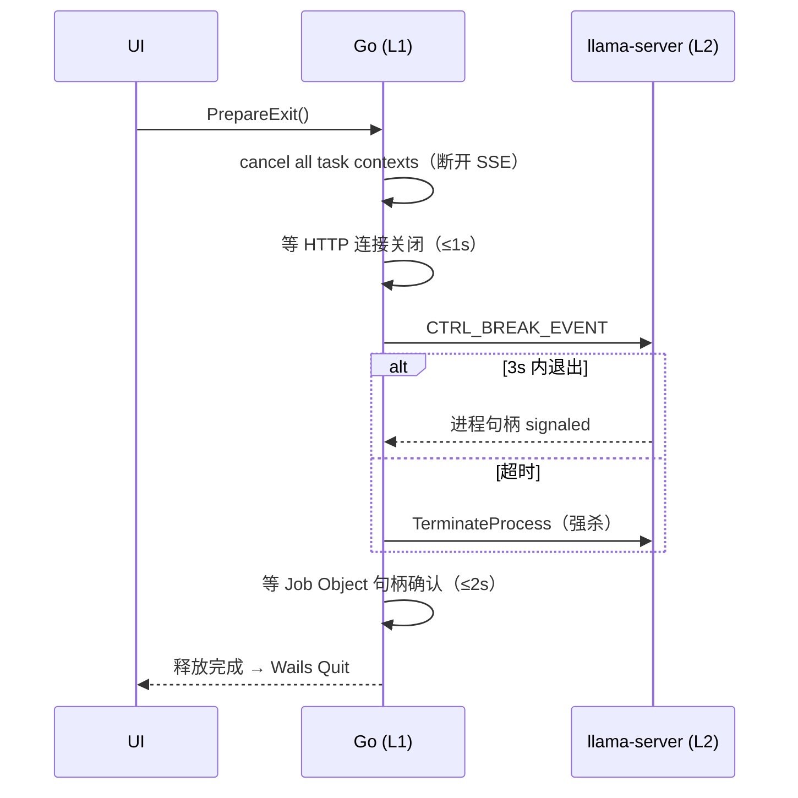

# Index-VT 执行细节说明

| | |
|---|---|
| **版本** | 1.0（M1 设计冻结候选） |
| **日期** | 2026-10-04 |
| **性质** | 风险与坑的记录。多数判断仍有效，实现类条目已按现状校正 |
| **读者** | M2-M6 里程碑的实现工程师 |
| **配套** | 01-设计方案文档.md（架构与模块定义） |

> 每个风险条目按 **现象 → 原因 → 对策** 三段式给出。标记 `[assumption]` 的数值为待 M2 实测校准的目标。

> 2026-10-05 校正说明：本文件的坑清单大多已落地成代码，`orchestrator`/`winproc`/`modelmanager` 的注释直接
> 引用这里的章节号，所以正文保留原样。只有若干条与实现不符或已过期，就地改了：§1 的 llama-server 获取方式、
> §3 的 ctx 档位落点、§9 的构建命令、§11.7 的虚拟化库、§12 的字体许可。
> 尚未实现的对策只剩 §11.2 覆写标签剥离回填之外的一小部分；01 文档 §5.4 的
> cue 编辑五操作与样式库增删改指派**已于 2026-10-08 落地**（`subtitle/edit.go`
> 五操作+删除插入+Styles/SetStyle/AssignStyle，`astisub.go` 样式结构化解析/序列化，
> 20 个表驱动测试，10 个后端绑定）。§11.2 覆写标签剥离回填、§11.5 双语三模式都已落地。
> `[assumption]` 数值一律未做真机校准，不得当作实测结论。

---

## 1. llama.cpp 版本红线

- **现象**：用旧版 llama.cpp 加载官方 GGUF 报错 `unknown model architecture 'qwen3.5'`，或加载后输出乱码。
- **原因**：Index-Translate 系列基于 Qwen3.5 底座，官方 GGUF 于 2026-10-03 用 llama.cpp master（2026-10）转换；Qwen3.5 架构支持是 2026 年 9-10 月合入的，旧版本不识别。
- **对策**：
  - 硬性要求：`thirdparty/llama-server/` 内分发的 llama-server.exe **构建日期 ≥ 2026-10-03**。M2 第一周以官方仓库 README 的 `llama serve -hf IndexTeam/Index-Translate-2B-GGUF:Q4_K_M` 冒烟验证。
  - 获取路径优先级：① llama.cpp 官方 GitHub Releases 预编译 CUDA 包（`llama-<ver>-bin-win-cuda-x64.zip`，含 cudart 依赖，免编译）；② 本地 CMake 编译（`cmake -B build -DGGML_CUDA=ON -DCMAKE_BUILD_TYPE=Release`，需 CUDA Toolkit 12.4+ 与 MSVC）。默认取 ①，仅在需要裁剪/调试时用 ②。
  - 版本锁定：原文计划的 `scripts/fetch-llama.ps1` 不存在，也没有自动拉取。当前做法是手工把官方
    CUDA 包里的 `llama-server.exe` 连同 .dll 放进 `thirdparty/llama-server/`，版本要求由人在放置时核对；
    升级同样靠手工替换后重跑验收用例。
  - **坑**：官方 GGUF 仓库附带的 `mmproj` 文件是给视觉塔的（模型卡原文"only needed for image-input use"），本项目**不下载、不使用**，避免误导入。

## 2. VRAM 预算表与降级策略

| 显卡档 | 推荐配置 | 预期占用 | 说明 |
|---|---|---|---|
| 4GB（GTX 1650/1050Ti 级） | Q4_K_M + ctx 8K + `-ngl 28`（部分层卸载） | 权重 1.31GB 全上卡，其余层驻内存 | 激活/KV 共享内存，速度约降 30% [assumption] |
| 6GB（RTX 2060/3060 Laptop 级） | Q4_K_M + ctx 8K，`-ngl 99` | ≈3GB | ctx 16K 需关闭其他占显存程序 |
| 8GB+（RTX 3060 12G/4060+） | Q4_K_M 全档可用；Nailong ctx 32K；Q8_0 可选 | 3-5GB | 全功能档 |
| 无 NVIDIA GPU | `-ngl 0` + `-t 物理核心数` | 0（纯内存） | 启动横幅明确提示性能差异 |

- **现象**：任务进行中 UI 卡死或 OOM 弹窗（CUDA error: out of memory）。
- **原因**：KV cache 随 ctx 二次方级增长（Qwen3.5 类架构，8K→32K 的 KV 增量约 2-3GB [assumption]）；或用户显存被游戏/浏览器占用。
- **对策**：① llama-server 启动前用 `nvidia-smi` 读 `memory.free`，若 `< 模型预估占用` 则自动降 `-ngl`（占用由 `internal/vramestimate` 按**权重 + ctx** 算，2026-10-06 起；旧写法不看 ctx）并在 UI 提示；② 运行中 OOM 由 orchestrator 捕获非零退出码 → crashed 态 → 以更小 `-ngl` 重启（最多 2 次）→ 提示用户改小 ctx 档或关闭其他程序；③ 首次引导的环境检测页直接展示"本机推荐档位"。

## 3. Nailong 长上下文现实化

- **现象**：直接用 `-c 262144` 启动，llama-server 直接分配数百 GB KV 或启动极慢/失败。
- **原因**：GGUF 标称 262144 positions（HF 配置），但 KV cache 实际占用 = ctx × 层数 × 2(K/V) × head_dim × 2bytes(bf16)；2B 模型 26 万 ctx 的 KV 远超消费级显存。
- **对策**：
  - UI 暴露 **8K / 16K / 32K** 预设 + **自定义 2K–64K（步进 1K）**，都在「设置 → 上下文档位」
    （`pages/Settings.tsx`），默认 **8K**（`config.go`）而非原文的 16K。自定义档保存前会按
    线性模型估算显存占用（`EstimateCtxVRAM`，2026-10-06 起为**实测标定**，见下），超可用显存时红字提示并二次确认
    （`仍要使用` 才能落库）；无 GPU 时只提示 CPU 模式的性能影响。落库字段
    `inference.ctxTokensOverride`（0 = 跟随预设档），`Normalize` 负责夹取与 1024 对齐。
    ~~[assumption] 估算模型对 2026-10-04 版 §3.2 表校准（8K→2726MiB、32K→5351MiB）。~~
    **该式已于 2026-10-06 实测重标**：把上下文真填满后拟合得
    `非权重 = 243 + 93.7×(ctx/8192)`（逐点 ±2.6%），代码取 `120 MiB/8K + 260 MiB` 偏保守 3–16%。
    旧常数的斜率高估 **9.3 倍**，且 `int(tokens/8192)` 的整除让 2K/4K 档 KV 项恒为 0——
    两个缺陷叠加的后果是 16K 以上一律误判超限，把 4GB 卡上本来能跑的 32K/64K 标成不可用。
    公式本体现在住在 **`internal/vramestimate`**（`EstimateCtxVRAM` 只是它的一层包装），
    回归测试 `vramestimate.TestForNeverUnderPredictsMeasured` 用五个实测点单向钉住（许高报不许低报）。
    **同一天把 `-ngl` 自动判定也并了进来**：`orchestrator.resolveNGL` 原先另用一套
    「权重×1.1 + 固定 700 MiB」且**完全不看 ctx**，在 64K 档低估约 231 MiB——
    剩余显存落在 `[2036, 2267]` 窗口时会误判"够"、下发 `-ngl 99` 然后加载失败。
    现在它调同一个 `vramestimate.For(...)`，并有 `decideNGL` 纯函数测试覆盖该窗口
    （`args_test.go`）。两处曾各持一套常数，正是"设置页说放不下、启动器说放得下"的根源。
  - `stop_token_ids=[248044, 248046]` 必须随请求下发（官方 doc_translate.py 的终止符配置；缺失会导致模型输出无法终止或续写多余内容）。llama-server 的 OpenAI 扩展字段为 `stop_token_ids`；若分发构建不支持该字段，回退方案：请求体用 `"stop": [...]` 传 token 字符串，或在启动参数 `--chat-template` 层处理——M2 验证后固化其一，写入 ADR 修订。
    实测结论：走原生字段，`ChatRequest.StopTokenIDs` 直接序列化为 `stop_token_ids`
    （`translator/sse.go:44,79`、`translator.go:229`），两个回退方案都没用上。
  - 文档超过所选 ctx（输入+输出）时前端预检：~~按 tokenizer 近似（中文≈1.6 token/字 [assumption]）~~
    **该近似已于 2026-10-06 实测替换**——`llama-tokenize` 直量得小说正文 **0.690 token/字**、
    技术中文 0.405、中英混排 0.550，**必须按文体分档，不能一个常数**；
    中译英的输出膨胀比实测 **0.893 token/源字**。估算并提示升档或拆分。
    长文档链路已于 2026-10-08 实现（`docpipeline/`：chunker 按 token 预算分块 +
    pipeline 队列 + 术语注入 + 覆盖率度量，6 个后端绑定；前端页面已写但导航
    尚未接入，见 README「已知限制」）。
    数据见 `docs/superpowers/specs/2026-10-06-m5-longdoc-feasibility.md` §7.1/§7.3。

## 4. 模型下载与本地管理

- **现象 A**：下载到一半失败，重启后续传得到损坏 GGUF，加载报 `invalid GGUF magic`。
- **原因**：HF 与 ModelScope 的 ETag/分块策略不同；跨源续传会把不同源字节拼接。
- **对策**：续传**仅限同源**（`.part` 文件记录源 URL + ETag；切源即删除 `.part` 重下）；下载完成后按官方仓库公布或文件页的 SHA256 校验，失败自动重下一次；`.part` 与 `.gguf` 同目录，完成后原子重命名。

- **现象 B**：用户手动放入的 GGUF 未被识别，或被误判为其他模型。
- **原因**：仅靠文件名（`Index-*-2B.Q*.gguf`）会在改名/重复文件时误判。
- **对策**：双重识别——文件名模式初筛 + GGUF 头 metadata 确认（`general.name`、`general.architecture`、`general.file_type` 量化枚举）；解析器需处理 GGUF v3 小端头（magic `GGUF`、64 位字段计数）。识别失败的文件列入"未知文件"区，允许用户手动指派类型后登记。

- **现象 C**：国内网络下载 HF 文件 100% 失败或 <100KB/s。
- **原因**：huggingface.co 直连不可达。
- **对策**：下载器默认双源探测（HEAD 并发，5s 超时，择连通且延迟低者）；ModelScope 直链格式 `https://modelscope.cn/models/IndexTeam/{repo}/resolve/master/{file}`（M2 验证实际路径）；设置页可固定偏好。探测结果缓存 10 分钟，失败任务允许手动"切换源重试"。

- **现象 D**：磁盘不足（三个模型 Q4 共约 4GB + Q8 档翻倍）。
- **对策**：下载前检查 `models/` 所在盘剩余空间（需 文件体积×1.2），不足时提示清理或改档位；模型中心显示每模型磁盘占用与合计。

## 5. 进程/端口健壮性

- **现象 A**：8101 被占用（用户自己跑着其他 llama.cpp 工具），启动失败。
- **原因**：llama-server 绑定端口冲突直接退出。
- **对策**：端口池 8101-8110 启动前 TCP 探测，冲突递增；启动后 `/health` 轮询（500ms 间隔，15s 超时判失败）；端口选择结果记入日志与 GetSystemStatus。

- **现象 B**：主程序退出后任务管理器仍有 llama-server.exe，显存仍被占用。
- **原因**：未绑定 Job Object 的子进程在父进程退出后存活。
- **对策**：见 §6（Job Object + 退出编排 + 启动清扫三重保险）。

- **现象 C**：双开程序导致两个 llama-server 抢显存。
- **对策**：named mutex `Global\IndexVT-SingleInstance`（`ERROR_ALREADY_EXISTS` 时激活已有窗口并退出自身）。

- **健康检查与重启退避**：运行中每 10s 探活 `/health`（2s 超时）；连续 2 次失败 → 判定崩溃 → 指数退避重启（1s/2s/4s），3 次后转 crashed 并提示用户（附"收集日志"按钮）。

## 6. 资源释放与进程生命周期（重点）

### 6.1 空闲卸载计时器

- 实现：`orchestrator` 内 Go ticker（1s）扫描 `activeTaskCount`（atomic 计数，任何翻译/字幕/文档任务 +1）与 `lastTaskDoneAt`；`now - lastTaskDoneAt > idleTimeout && activeTaskCount==0` 时触发。
- **竞态锁序**（关键坑）：新任务路径 = 获取 `taskMutex` → `activeTaskCount++` → 检查卸载中标志 → 若正在卸载则中止停止流程并等待复用；卸载路径 = 获取 `taskMutex` → 复核 `activeTaskCount==0` → 置 `stopping` 标志 → 释放锁 → 执行停止。两处都必须**持锁复核计数**，防止"停止进行到一半时新任务到达导致状态机错乱"。
- 卸载完成后模型态转"休眠"；设置页 `idleTimeout` 取值 1-30 分钟或"常驻"（0），默认 5 分钟。

### 6.2 llama-server 优雅停止方式（Windows 无 SIGTERM）

| 方式 | 行为 | 采用 |
|---|---|---|
| `taskkill /PID <pid> /T`（无 /F） | 发 WM_CLOSE，控制台程序多数不响应 | ✗ |
| `GenerateConsoleCtrlEvent(CTRL_BREAK_EVENT, pgid)` | llama-server 注册了 signal handler，收到后 flush 并退出（llama.cpp 官方支持 CTRL_C/BREAK 优雅退出） | ✅ 首选 |
| `TerminateProcess` / `taskkill /F` | 强杀，显存由驱动回收但可能留下锁文件 | ✅ 超时兜底（3s） |

- 顺序：CTRL_BREAK → 等 3s（轮询进程句柄 signaled）→ 未退出则 TerminateProcess → 等 Job Object 句柄（`WaitForSingleObject`，2s）→ 上报状态。
- **现象**：CTRL_BREAK 偶发不退出（模型在长生成中）。
- **对策**：停止前先断开任务 SSE（客户端取消即触发服务端中断），再发停止信号；超时兜底保证最终释放。

### 6.3 退出编排时序

- UI 侧显示"正在释放模型资源…"（约 1-5s），不可跳过（保证零残留优先于退出速度）。
- 崩溃路径：主进程被 `taskkill /F` 或崩溃 → Job Object（`JOB_OBJECT_LIMIT_KILL_ON_JOB_CLOSE`）句柄关闭 → 内核终止子进程。M2 验证此行为并纳入 F-14 用例。

### 6.4 启动残留清扫

- 匹配三重指纹：`进程名 == llama-server.exe` AND `命令行包含 <本机项目>\models\` AND `监听端口 ∈ 8101-8110`。
- **坑**：用户可能自己跑 llama.cpp——三指纹缺一不杀；清扫结果记日志并在引导页展示"已清理 X 个残留进程"。
- 实现依赖：Windows WMI/`wmic` 已弃用 → 用 `golang.org/x/sys/windows` 枚举进程 + `NtQueryInformationProcess` 读命令行（封装一次，M2 落地）。

### 6.5 显存释放验证方法

- 验收口径：卸载/退出前后各执行一次 `nvidia-smi --query-gpu=memory.used --format=csv,noheader`，差值应回到基线（±50MB 容差，驱动缓存除外）。
- "模型唤醒"首任务延迟目标 ≤15s [assumption]（Q4_K_M 2B 权重 1.31GB，PCIe 3.0 x16 NVMe→显存拷贝 + 图初始化），UI 显示"模型唤醒中…"进度提示。

## 7. 流式与取消

- **现象 A**：打字机渲染在长输出时前端掉帧（React 状态每 token 重渲染整段）。
- **对策**：Wails Events `translate:delta` 批量化（50ms 合并窗口）；前端对输出区用 `requestAnimationFrame` + 末尾段落 memo；超过 10K 字符切换"追加区"模式。

- **现象 B**：取消后 tokens 仍在生成（服务端未停）。
- **对策**：取消 = `context.Cancel()` → Go http 客户端断开 → llama-server 检测到客户端断开即中止该 slot 生成并释放（官方行为，M2 用日志验证）。前端 Esc/按钮 ≤100ms 反馈"已取消"。

- **SSE 解析坑**：llama-server 的 chunk 为 `data: {...}\n\n`，结尾 `data: [DONE]`；个别构建对 UTF-8 多字节 token 会拆分——解析器必须按字节缓冲到完整 JSON 再解码，不能按行直切。

## 8. Homura（配音模式）细节

- **音节近似性**（官方数据：9B 在 SandGlass 基准 81.92% 落在目标 ±10% 区间；2B 更弱）→ UI 措辞用"实测 N 音节（目标 M）"而非"已达标"；提供"重新生成"（temperature=0.3 采样，每次结果不同）与"手动改写"两条路。
- 实测音节计算：英语按元音组启发式（不含 e 尾音）、日语按 mora、其他语言按 Unicode 音节切分——前端实现，标注"启发式统计"。
- `max_tokens = max(512, 3×len(源文))`：防止音节预算大时译文被截断（官方脚本同款计算）。
- 术语表与音节预算可叠加（官方支持），prompt 模板见 01 文档 §4.2。

## 9. Windows 打包发布

- 构建：`node scripts/build.mjs`。它依次做前端构建、把 `frontend/dist` 同步进 `app/frontenddist`、再跑
  `wails build -s -clean -platform windows/amd64 -webview2 embed`。原文只写了后半条命令，照它裸跑会得到
  旧界面（`go:embed` 跨不了 `..`，embed 源不会自己更新），详见 README「构建」。embed 模式把 WebView2
  loader 打入，Win10 1809+ 原生支持；缺失 runtime 时引导 offline installer 链接。
- 分发物结构：原文的 `dist/Index-VT/` 目录与打包脚本都没做。当前产物是单个
  `app/build/bin/Index-VT.exe`（前端资源已内嵌），`llama-server.exe` 与 cudart 相关 dll 需手工与它放在一起；
  GGUF 不入包（首启模型中心下载或用户自备）。
- 版本信息与图标：`wails.json` 配置 + `resource/logo.ico`；签名（可选，无证书则跳过并在文档声明）。
- Inno Setup（可选脚本 `scripts/package.iss`）未做，`scripts/` 目前只有 `build.mjs`。安装包这层先跳过：
  运行时布局本来就是便携的（`models/` 与 `logs/` 随 exe 目录），不写注册表、不装服务。
- 增量更新：首版不做自动更新；设置页"关于"提供版本号与 Release 页链接（P2 手动检查）。
- 防病毒误报：Go + WebView2 单 exe 偶发 SmartScreen 提示——发布页附 SHA256 与"更多信息"说明文档。

## 10. 已知限制声明（UI 文案需如实）

| 限制 | 来源 | UI 呈现 |
|---|---|---|
| Nailong 仅 zh↔en / zh↔ja | 官方方向模板固定 | 文档翻译页四方向卡片，无自由语言对 |
| Homura 音节为近似达标 | 官方 SandGlass 数据 | 实测音节回显 + "近似"标注 |
| 2B 低资源语言 off-target 率 4.2% | 官方 FLORES_minor_pair 评测 | off-target 警告徽标 + 一键重试 |
| 术语/格式约束为模型能力而非硬保证 | instTrans 评测为概率性 | 约束面板说明文字"尽力保持"措辞 |
| CPU 模式性能显著低于 GPU | llama.cpp CPU 后端 | 启动横幅 + 任务时长预期提示 |
| 字幕时间轴精度依赖导入文件本身 | 本产品不做音频对齐（非目标） | 字幕工作台帮助 tooltip 说明 |

## 11. 字幕引擎细节

### 11.1 库选型与边界

- `go-astisub`（MIT）：承担 SRT/ASS/TTML/STL/WEBVTT 解析与序列化；**LRC 自研**（astisub 无 LRC 支持——`[mm:ss.xx]文本` 行格式 + 无结束时间，按下一行起始推算）。
- **现象**：ASS 解析后导出丢字体/颜色等 Style 定义。
- **原因**：astisub 对 ASS Style 元数据覆盖有限（部分版本仅保留文本层）。
- **对策**：M2 第一周做"ASS 往返保真测试"（roundtrip：解析→序列化→逐字段 diff）；若 Style 丢失率 >0，则在 astisub 之上补 ASS 元数据层（自持 `styles map` + 原始 headers），必要时切自研 ASS 解析（ASS 文本格式规整，`[V4+ Styles]`/`[Events]` 两段式，自研成本可控）。结论回写 ADR-007。

### 11.2 ASS 覆写标签保护

- **现象**：含 `{\i1}斜体{\i0}` 的行被整行送翻译，模型把花括号内容当文本翻译或丢弃。
- **对策**：翻译前剥离覆写标签（正则 `\{\\[^}]*\}`）记录位置与原文 → 纯文本送翻 → 译后按序回填标签（标签数不变时）；标签数变化（模型输出损坏）时丢弃标签并标记该条"需人工检查"。

### 11.3 时间格式陷阱

| 格式 | 时间分隔 | 坑 |
|---|---|---|
| SRT | `00:01:02,345`（**逗号**毫秒） | 导出 VTT 时必须转 `.`；解析需容忍 `\r\n` 与 BOM |
| WebVTT | `00:01:02.345`（点） | 可有 `.` 后 3 位以上，解析截断到 ms；`NOTE`/`STYLE` 块跳过 |
| ASS | `0:01:02.34`（**2 位** ms，H 单数字） | 序列化保持 2 位，SRT→ASS 需 ÷10 舍入（四舍五入会造成 ±5ms 漂移，统一 banker's rounding） |
| LRC | `[01:02.34]` 无结束时间 | 结束 = 下一条 start − 1ms；最后一条结束 = start + 5s（约定值，UI 注明） |

### 11.4 翻译队列与并发

- 单 worker 顺序请求（llama-server 默认 1 slot；开 `--parallel` 多 slot 会均分 KV cache 且 2B 吞吐下并发收益低 [assumption]），每条非流式（`stream:false`）拿全文，队列事件 100ms 合并推送。
- 长单条（>200 字符字幕，少见）允许正常处理，max_tokens 512。
- 失败重试 ≤2 次后标 failed；"重试失败"按钮只取 failed 子集。
- **进度基准**：5000 cue 短句文件，Q4_K_M @ RTX 3060 级 ≥5 条/s [assumption]（单条 ≈30 token 输出、30 tok/s 吞吐上限推导），M4 实测校准。

### 11.5 双语合成与播放器兼容

- 双行模式：原文上、译文下，同一 cue 内 `\N`（ASS）/`\n`（SRT 第二行）分隔。
- **坑**：部分播放器（含部分安卓端）对三行以上渲染截断——双语限制为两行；导出对话框注明。
- LRC 双语：LRC 无双行标准，导出为"译文替换模式 + 原文另存 .lrc.orig"。

### 11.6 编码与 BOM

- 导入：UTF-8（含/不含 BOM）、UTF-8-SIG、GBK（`golang.org/x/text/encoding/simplifiedchinese` + chardet 探测）。
- 导出：默认 UTF-**无 BOM**（现代播放器标准）；GBK 选项用于老旧设备（字幕组真实需求），导出对话框标注"部分特数字符可能丢失"。
- **坑**：Windows 记事本传统 UTF-8 带 BOM 会被个别播放器显示为首行乱码——导出默认无 BOM，导入端容忍 BOM。

### 11.7 大文件性能

- 5000+ cue 的虚拟化：原文点名的 `@tanstack/react-virtual` 没有引入，改为自研固定行高虚拟化
  （`frontend/src/lib/virtualizer.ts` + `components/ui/DataTable.tsx`，Track B 已做并有
  `verify:datatable` 门禁：5000 行只渲染视口 + 12 行、无 >200ms 长任务）。但字幕工作台还没换成 DataTable，
  字幕工作台已换成 DataTable（M4，56px 行高，`SubtitleWorkbench.tsx`）。
  cue 编辑已实现（`edit.go`），每次编辑即时提交 Go 并返回权威快照；
  未做"编辑事件防抖 300ms 批量提交"——行内编辑频率低，逐条提交更简单且可回滚。
  导出不是流式：`Engine.Export` 先在内存里拼出完整字节再 `os.WriteFile`（`subtitle/engine.go:309`），
  原文的"Go 侧流式写文件、不经过前端内存"只兑现了一半（确实不过前端内存，但是整块写）。

## 12. 依赖许可清单

| 依赖 | 许可 | 用途 | 合规注意 |
|---|---|---|---|
| llama.cpp（llama-server） | MIT | 推理 | 附 LICENSE 副本于 thirdparty |
| Index-*-2B GGUF 权重 | Apache-2.0 | 模型 | 设置页"关于"标注来源与许可 |
| React / Tailwind CSS / lucide-react / zustand | MIT | 前端 | — |
| modernc.org/sqlite | public domain（代码）/ SQLite 各组件许可 | 持久化 | — |
| go-astisub | MIT | 字幕格式 | — |
| golang.org/x/text | BSD-3 | GBK 编码 | — |
| Inter / JetBrains Mono（本地 woff2 子集） | SIL OFL 1.1 | 界面字体 | **仓库尚未附许可证副本**，`frontend/src/assets/fonts/` 只有两个 woff2；发布前必须补 LICENSE，且子集只覆盖拉丁，CJK 走系统栈 |
| Silero VAD | — | **不使用**（无音频链路） | 明确排除，避免误引 |
