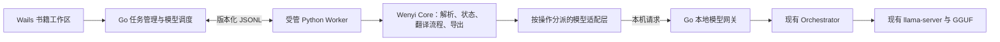

# Wenyi 接入 Index-VT：可行性、分支方案与本机速度

日期：2026-10-25（Asia/Singapore）。方案分支：`codex/wenyi-local-integration`。

本次用 Exa 做了两轮检索，共检查 10 条搜索结果，并进一步核对 Wenyi v1.2.7 的官方配置、架构和代码。结合当前仓库代码，在本机实际运行了两个模型、共 10 个探针请求。**当前产物是接入设计、可复跑探针及其结果；尚未实现产品内的 Wenyi 工作区，也没有运行 Wenyi 的完整流水线。**

## 1. 结论与建议

**可行。建议复用 Wenyi 的 Python Core，在 Wails 内新增书籍工作区，由项目现有的模型管理器和 llama-server 执行推理。** 第一阶段以本地正文翻译、段落对应、人工术语、保存进度和 EPUB 导出为目标。

“能连上模型”已经有较强证据：“三段原文 → JSON 译文数组”的代表性探针，两款模型都一次通过。但完整 Wenyi 还需要摘要、风格分析、术语抽取、证据核验和修订；现有三款模型没有因此自动获得这些能力。本轮 Translate 的简单分析返回了源文没有的词；Nailong 的分析输出发生重复并触及上限。

| 范围 | 可行性判断 | 推进条件 |
| --- | --- | --- |
| Wenyi 通过本地端点调用现有模型 | 高；接口和短样本已有证据 | 补足动态端口、模型生命周期及上下文预算管理 |
| 书籍解析、翻译、术语约束、进度保存和 EPUB 导出 | 较高；需编写适配层 | 实际文件往返、跨进程续跑及批次协议验证 |
| 直接用三款 2B 模型跑完整默认流程 | 尚不足以作为发布方案 | 对各操作分别验证格式、事实依据和任务完成率 |
| 全功能流程，另加通用指令模型 | 工程上可扩展 | 新增模型登记与能力验证；4GB 显存优先串行切换模型 |

Wenyi Core/CLI 与桌面外壳已经分离；Core 不依赖 HTTP 框架，进度通过回调传递。这个边界适合由 Wails 托管。[上游架构](https://github.com/BigDawnGhost/wenyi/blob/v1.2.7/docs/architecture.md)、[进度事件接口](https://github.com/BigDawnGhost/wenyi/blob/v1.2.7/packages/core/wenyi_core/events.py)。

## 2. 仓库现状与真正需要补的部分

| 已核对的位置 | 当前行为 | 接入影响 |
| --- | --- | --- |
| `app/internal/modelmanager/registry.go` | 只登记 Translate、Nailong、Homura；支持 Q4_K_M / Q8_0 | 第一版复用这些模型；全功能模式若增加模型，需要显式扩展登记和识别 |
| `app/internal/orchestrator/args.go` | `127.0.0.1`、动态端口、`-fa on`、`--parallel 1` | 不能把 Wenyi 配成写死的端口，也不能照搬其默认四路并发 |
| `app/app.go` 的 translator 依赖注入 | 通过 `TaskBeginContext` / `TaskDone` 持有推理任务 | 外部 worker 的模型请求也必须纳入这一生命周期 |
| `app/internal/translator/sse.go` | 已调用 `/v1/chat/completions`，支持 usage 与模型扩展参数 | 可复用 HTTP/采样/取消相关能力；现有请求类型不包含通用 JSON mode，不能假设接口已经全部齐备 |
| `app/internal/translator/prompt_translate.go` | 支持术语、风格及 JSON 字典保留提示 | 能作为适配基础；JSON 字典翻译与 Wenyi 的批次数组协议仍需分别验证 |
| `app/internal/translator/prompt_homura.go` | Nailong 四方向模板以及固定译名注入 | Nailong 限制到中英、中日双向；不能把摘要直接塞进源文区域 |
| `app/internal/docpipeline/pipeline.go` | TXT/MD 分块、同会话续跑、术语命中统计 | 新书籍项目采用独立持久状态；现有内存文档对象不能直接当成 Wenyi 断点 |

Wenyi 的 OpenAI-compatible provider 使用标准 Chat Completions；JSON 模式传 `response_format: {type: json_object}`，并在消息中补充 JSON 指令，默认非流式调用。**因此嵌入后首先能展示的是阶段/批次进度；要在正文区逐 token 显示，需要另外增加流式支持。** [provider 实现](https://github.com/BigDawnGhost/wenyi/blob/v1.2.7/packages/core/wenyi_core/llm/providers/_openai_compatible.py)。

## 3. 推荐结构



以上是拟实现的结构，不是本分支已有的服务。

1. **保留 Wails 作为唯一应用外壳。** 新页面负责项目列表、导入、原文/译文、术语和导出。先提供最小任务界面，再做深入校对界面。没有必要把完整 Tauri 桌面应用再启动一遍。
2. **Go 管理 worker 子进程。** 开发阶段使用受控 Python 环境，发行阶段打包独立运行时/worker；不让最终用户安装 Python。固定上游 tag 与依赖锁文件，再记录完整提交标识。
3. **JSONL 作为应用与 worker 的协议。** 最小命令包括 `create`、`start`、`cancel`、`resume`、`export`；事件包括 `phase`、`progress`、`batch_done`、`failed`、`completed`。stdout 只承载协议，诊断输出走 stderr。协议具备版本、项目 ID 和请求 ID。
4. **模型请求通过本地网关。** 网关固定面向 worker 的地址，后端按当前模型解析真正的动态 llama 端口；处理取消、任务计数、上下文预算与 usage。只监听回环地址，使用每次启动生成的凭据。独立探针直接启动临时 server，仅用于本次测量。
5. **串行执行推理。** 全书任务持有应用级任务占用，跨批次仍保护模型选择及引擎参数；每次 HTTP 请求配对任务计数。初版一本书一个活动任务，预扫和审校并发设为 1。单 slot 不等于并发请求绝对不能排队，但不能据此承诺吞吐提升。
6. **独立工作区保存。** 建议在便携数据根下新增 `wenyi/projects/<id>/`，保存来源标识、配置快照、批次状态、Wenyi 存储和导出记录。复用 Core 的存储协议；选定一种存储实现并固定版本。避免把其内部表直接塞进现有 `indexvt.db`。
7. **取消与退出形成闭环。** 先取消推理连接，再让 worker 完成可恢复状态写入，最后回收子进程；Windows 使用受管进程树。退出后重启应用，应只继续未完成批次。

## 4. 模型分工和两种运行模式

### 4.1 第一阶段：仅用项目现有模型

- 正文默认先用 **Index-Translate-2B Q4_K_M** 验证 Wenyi 原生批次协议；本轮它的三段 JSON 探针已通过。
- **Index-Nailong-2B** 作为长篇中英、中日双向的对照或可选路径，采用当前已经存在的方向模板和术语约束。不能把本轮共用普通翻译提示词的速度测量称为生产 Nailong 模板的质量验收。
- **Homura** 保持面向音节约束的用途，第一阶段没有证据表明它能改善书籍摘要、分析或审校，不把它当作审校模型。
- 用户明确源/目标语言，使用现有人工术语本；自动风格分析、全书梗概、动态术语抽取、自动审校和自动发布修订，需在接入路径中明确关闭或替换。

这需要**专门的 Core 适配路径**。不是只给原版 Wenyi 写一个 YAML：`book_understanding: false` 只跳过摘要，非空书籍仍会执行 `analyzer.analyze(sample)`。不能向这些操作返回空 JSON，再把界面标成“全书理解/审校成功”。[准备流程代码](https://github.com/BigDawnGhost/wenyi/blob/v1.2.7/packages/core/wenyi_core/pipeline/preparation.py)。

正文保留两级策略：先测试 Wenyi 原生批次输出；格式或数量失败时，有限重试，再按稳定段落 ID 单段翻译，由程序组装数组。始终保留已经确认完成的段落，不能用空字符串假装完成。Wenyi 本身已有类似的批次恢复逻辑，但最终单段回退仍要求 JSON 输出；若采用程序包装普通译文，需要增加自己的 translator 适配器。[翻译 Agent](https://github.com/BigDawnGhost/wenyi/blob/v1.2.7/packages/core/wenyi_core/agents/translator.py)。

### 4.2 后续：完整工作流

完整流程可以按操作分派：翻译操作交给 Index，摘要、分析、抽取和审校交给经过验证的通用指令模型。Wenyi 已有 `llm.routes`，支持 `analysis.style`、`translation.body`、`glossary.extract`、`review.*` 等独立路由。[配置与操作表](https://github.com/BigDawnGhost/wenyi/blob/v1.2.7/docs/configuration.md)。

4GB 卡上先采用按阶段加载一个模型的方案。新模型是否支持当前 llama.cpp 构建、实际显存、切换时间和速度都要另测；本报告的 87 token/s 不能套到另一款模型。正文阶段如每批都切换模型抽取术语，额外加载会反复付出成本，应先测清楚再决定调度策略。

## 5. 不能省略的协议与质量检查

| 检查 | 第一阶段的处理 |
| --- | --- |
| 格式正确但含错误信息 | 抽取词必须回溯原文；译文按人工样本复核。JSON 合法只代表语法通过 |
| 输出截断 | `finish_reason=length` 明确失败，拆小批次后重试，不保存成完整译文 |
| 段落数量/顺序变化 | 稳定 ID 与数组长度检查，有限重试与单段回退 |
| 批次超出真实上下文 | 使用当前模型的 tokenizer 计算消息及输出预算，包含模板、术语、历史；Wenyi 的 cl100k_base 只是分批启发式 |
| 全量术语使提示词越来越长 | 保留完整术语数据，按输入窗口控制注入预算；若偏离 Wenyi 原生全量注入，需要明确记为本地适配行为并比较一致性 |
| 模型切换或空闲释放打断任务 | 应用级全书任务占用，加请求级 TaskBegin/TaskDone；取消、失败都配对释放 |
| 新版提示词导致状态不兼容 | 保存上游版本、模型、量化、语言、提示词/术语版本与源文身份；验证 Core 原有缓存和恢复契约 |

第一阶段支持 TXT/MD 与 EPUB，先验收实际 EPUB 的样式、图片、目录和段落对应。PDF 单独排后：Wenyi 默认依赖外部 MinerU，另一路是独立 BabelDOC 服务，不能因为模型在本机就称 PDF 流程已经离线。[CLI 格式说明](https://github.com/BigDawnGhost/wenyi/blob/v1.2.7/docs/cli.md)。

## 6. 本次实测：速度

硬件：RTX 3050 Laptop GPU 4096 MiB；CPU 为 i5-12500H；驱动 591.86。引擎为 llama.cpp b11406 / `8216c8462`。

参数：Q4_K_M、全层 GPU（`-ngl 99`）、8K 上下文、Flash Attention、单 slot、temperature=0、关闭 thinking。使用自撰 349 字符中文小说片段，中译英；每模型预热后重复 3 次。短样本只有 249 个输入 token，后两次请求命中前缀缓存，因此不能代表长书的完整请求耗时。

| 模型 | 实际输出 token/次 | 引擎 decode token/s：三次 | decode 中位数 | 完整请求输出 token/s 中位数 |
| --- | ---: | --- | ---: | ---: |
| Index-Translate-2B Q4_K_M | 297 | 88.31 / 87.20 / 86.98 | **87.20** | **85.54** |
| Index-Nailong-2B Q4_K_M | 295 | 87.35 / 86.85 / 86.73 | **86.85** | **85.41** |

decode 取 server 返回的 `timings.predicted_per_second`；完整请求速度为 `usage.completion_tokens / 请求墙钟时间`。后者包含提示词计算和本机 HTTP 返回。两者都不是“每秒汉字数”，也不等于用户最终得到的有效正文速度。

本轮两次模型冷启动到健康端点分别为约 1.75 秒、2.01 秒；这只是当前文件缓存和机器状态下的两次观察，不是切换时间保证。

### 6.1 长上下文：已有本机记录

仓库 2026-10-06 的 Nailong Q4 实验实际填充了约 90% 上下文，而非仅分配一个大窗口。该记录可帮助估算长文性能，但不是今天重新跑出的数据。它引用的历史原始产物未入库，可复现性弱于本轮随报告保留的探针。

| 窗口/实际输入 | 历史 decode token/s | 历史首 token 延迟 |
| --- | ---: | ---: |
| 8K / 7,471 token | 83.77 | 2.61 秒 |
| 16K / 14,833 token | 80.82 | 5.22 秒 |
| 32K / 29,561 token | 75.15 | 11.13 秒 |
| 64K / 60,069 token | 64.76 | 25.80 秒 |

出处：[历史长文档实验 §7.7](../docs/superpowers/specs/2026-10-06-m5-longdoc-feasibility.md)。该文件前半部分记录的是当时的旧实现，不能当作今天的功能清单。

**本机规划值：**小输入约 85–88 token/s；真实较长输入按 8K–32K 的约 75–84 token/s 估算，64K 接近填满时约 65 token/s。是否热降频、后台 GPU 占用、是否回落 CPU、实际输入长度和量化都会影响结果；Q8、CPU 模式及额外通用模型本轮未测。

### 6.2 Wenyi 的总耗时怎么算

```text
总耗时 ≈ 模型加载/切换
       + Σ（实际未缓存输入 token / prefill 速度）
       + Σ（所有阶段生成 token / 对应模型 decode 速度）
       + 解析/导出/状态写入/重试耗时
```

作为示例，**2 万汉字小说中译英，只生成一遍正文**：历史样本为约 0.893 输出 token/源字，即约 17,860 输出 token；按 75–85 token/s，纯生成约 3.5–4 分钟。加分批输入、术语上下文和保存等，初步预算约 **4–6 分钟**。这是外推，不是本轮实测的整书时间；语言方向和文体改变时，输出比例也会改变。

Wenyi 标准模式启用润色时，正常正文批次会有翻译和润色两次调用；三稿综合模式则有三份初稿及一次综合，另加摘要、抽词、审校、修订与重试。若几次正文输出长度相近，仅这部分的有效正文吞吐就大致除以 2 或 4。审校循环和提示词消耗另计，不能给完整流程一个固定的 token/s 或承诺“4–6 分钟”。[批次执行代码](https://github.com/BigDawnGhost/wenyi/blob/v1.2.7/packages/core/wenyi_core/pipeline/translation_batch.py)、[发布说明](https://github.com/BigDawnGhost/wenyi/releases/tag/v1.2.7)。

## 7. 本次实测：结构化输出与能力边界

以下使用自写代表性请求，不是 Wenyi 原版提示词或完整 Agent 的端到端测试。JSON mode 也使用了 llama-server 的格式约束，不能据此把格式能力全部归功于模型。

| 探针 | Translate | Nailong | 能说明什么 |
| --- | --- | --- | --- |
| 3 段原文 → `translations` 字符串数组 | 一次通过，47 输出 token | 一次通过，63 输出 token | 短批次协议值得进一步验证；不能外推为所有长批次都成功 |
| 简单风格/人物/词汇 JSON，输出上限 512 token | JSON 与简化字段类型通过，311 token | 重复枚举并触及 512 上限，JSON 未完成 | 通用分析不能直接列为已支持；截断需要失败处理 |

Translate 返回的词汇里，“行李箱”“夜晚”“黎明”不是本样本原文中的字面词项；其中原文写的是木箱、行李房和日落前的情景。这个样本说明抽词存在无依据候选，不能自动升格为正式术语。Nailong 把地点/物体等列进人物并重复输出，直到上限。提高 token 上限有时能解决正常长回答的截断，但本次重复失控不能仅凭增加上限认定修复。

这仍只是各一个分析样本。没有做摘要、双语审校、真实长书及语言对的质量对照，不能据此宣称两款模型完全不能承担分析，也不能把简单 JSON 通过当作完整 Wenyi 兼容认证。

## 8. 分阶段实施与工作量

以下为熟悉当前工程的一位开发者的工程粗估；在每阶段出口重新估计。没有假定现有模型的分析质量问题已经解决。

| 阶段 | 实现内容 | 出口 | 估计 |
| --- | --- | --- | --- |
| P0：真实 Core 验证 | 固定 Wenyi 版本，构造小型 TXT/EPUB；验证本地 provider、原版翻译提示词、状态与导出；比较原生批次与适配器 | 实际 Core 跑通，至少一次中断后续跑，原文与段落身份保持 | 1–2 人日 |
| P1：可运行分支 | Python worker / JSONL、Go 本地网关、模型占用与取消、Wails 最小书籍页面；明确限制自动分析操作 | 从应用导入到导出；重启后能续跑；失败原因可见 | 3–5 人日 |
| P2：可发布功能 | EPUB 往返覆盖、进度校对、术语同步、运行时打包、异常退出恢复和许可证随包保留 | 干净 Windows 环境安装运行，状态及导出可验证 | 3–5 人日 |
| P3：完整分析与审校 | 通用模型能力测试、操作路由、阶段调度和质量对照 | 有人工质量证据且耗时可接受，才开启相应操作 | 另估 |

P0–P2 合计约 **7–12 人日**。格式复杂度、上游内部 API 的稳定性和 Windows 打包问题可能改变工期；只做 CLI 接线会更快，但不等于完成了程序内的书籍工作区。

Wenyi 上游许可证为 MIT。实际随包分发 Core/依赖时保留对应版权和许可文件；在当前第三方声明中登记固定版本。[Wenyi LICENSE](https://github.com/BigDawnGhost/wenyi/blob/v1.2.7/LICENSE)。

## 9. 本分支产物与复跑

- 本方案：`exa-results/wenyi-local-integration-2026-10-25.md`。
- 标准库探针：[scripts/wenyi-model-probe.py](../scripts/wenyi-model-probe.py)。
- 本轮原始结果，含自撰输入、所有输出、usage 与 server timings：[wenyi-model-probe-2026-10-25.json](../docs/research/wenyi-model-probe-2026-10-25.json)。

在项目根目录执行，先确保显存空闲；只会启动并回收本脚本创建的两个临时服务：

```powershell
python scripts/wenyi-model-probe.py --output docs/research/wenyi-model-probe-2026-10-25.json
```

命令会覆盖指定结果文件，需保留旧结果时改输出名。服务日志保存在被忽略的 `.tmp-wenyi-probe/`。执行环境必须允许本机回环 HTTP；本次沙箱默认禁用了本机套接字，因此在执行权限放开后完成了测量。已回收测试服务，未读取或修改应用数据库。

本次方案提交仅包含本报告、探针脚本和原始测速结果。原来未提交的 README、开发/发布文档和截图改动保留在工作区，不纳入本次提交。
